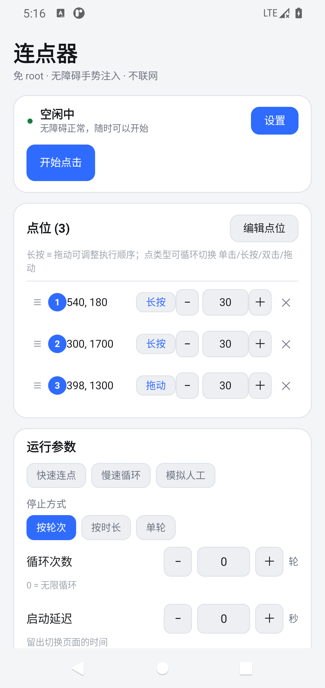
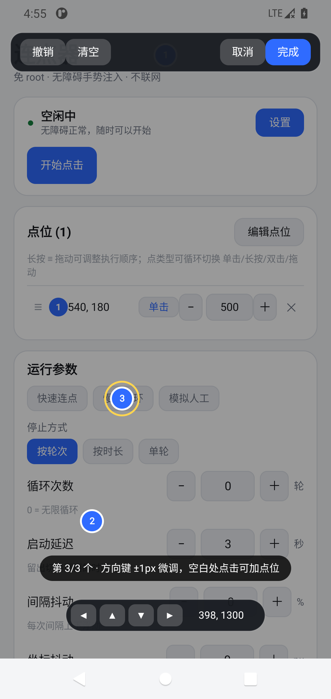
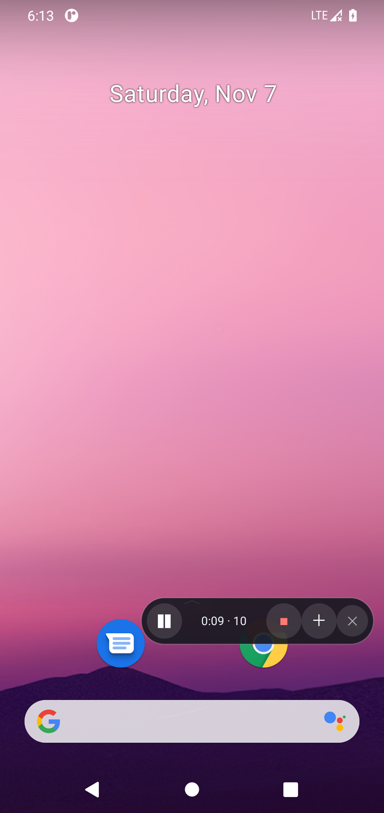
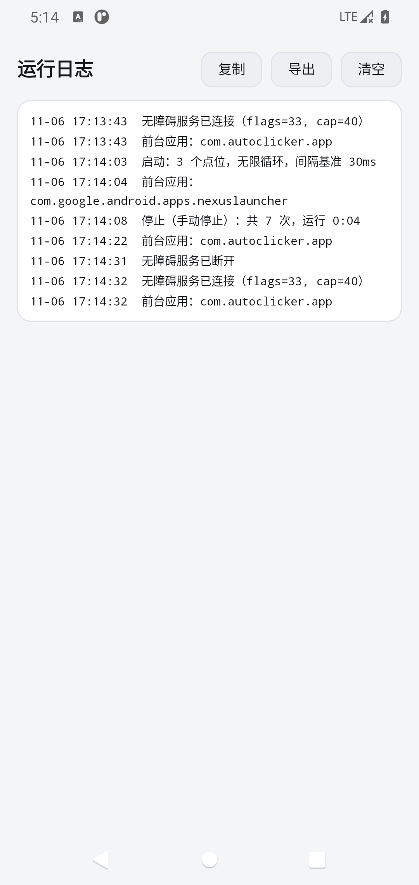

# 连点器 · AutoClicker for Android

免 root 的安卓自动点击器，基于无障碍服务的 `dispatchGesture` 注入手势。单机运行、不联网、无广告、无统计。

- **minSdk 24**（Android 7.0）/ target 33
- 纯 Kotlin，无第三方运行时依赖，APK 不到 1 MB
- 不需要「显示在其他应用上层」权限，悬浮面板走 `TYPE_ACCESSIBILITY_OVERLAY`

## 界面

| 主界面 | 取点模式 | 悬浮面板 | 运行日志 |
|---|---|---|---|
|  |  |  |  |

## 功能

**点位**

- 坐标拾取器：全屏取点，带半透明绘图预览与选中高亮
- **拖拽排序**：按住行首 `≡` 上下拖动，改变点击执行顺序
- **微调**：取点界面选中点位后，用 `◀ ▲ ▼ ▶` 逐像素调整
- **四种点击类型**：单击 / 长按 / 双击 / 拖动（拖动可设起点终点与时长）
- **每个点位独立间隔**：30–20000 ms，互不干扰，单个点位可单独删除

**运行控制**

- 多种停止方式：**按轮次** / **按时长**（运行 N 秒自动停）/ **单轮**（跑完一遍即停）；「按时长」从**真正发出第一次手势**开始计时，中途暂停会记账、继续后扣剩余时间，不会被暂停吞掉
- 启动延迟倒计时：状态卡大字倒计时 + 进度动画，看得见什么时候开始
- 悬浮控制面板：启动 / 暂停 / 继续 / 停止，实时显示 `时长 · 次数`，可拖动，只在本 App 之外出现
- **音量键控制**：音量+ 开始，音量− 停止（无障碍按键过滤，需系统支持）
- 状态区分：空闲中 / 倒计时中 / 运行中 / 暂停中，主按钮文字与图标同步变化

**参数输入**

- 所有数值都带 `−` / `＋` 步进按钮，不用反复调键盘
- **预设模板**：快速连点（30 ms）/ 模拟人工（800 ms + 抖动）/ 慢速循环（2 s）

**增强**

- 间隔随机抖动、坐标随机抖动：模拟真人节奏，避免固定周期
- 窗口锁定：只在你指定的应用内运行，切走自动暂停
- 方案管理：多套配置保存 / 切换 / 删除
- JSON 导入导出（SAF 文件选择器，无存储权限）

**日志与安全**

- 日志页：每次点击记录「点位序号 + 类型 + 实际落点坐标（含抖动）+ ✓/✗」，时间戳精确到毫秒，启动/暂停/停止/异常也都在里面，可复制或**导出 txt**
- 间隔硬下限 30 ms，杜绝 0 间隔把 CPU 打满
- 连续 10 次手势失败自动停止（防误触）
- **锁屏自动暂停**：熄屏立即停止注入，避免后台乱点（可关）
- **不在自己界面上乱点**：连点器自己的界面在前台时暂缓下发手势（状态卡会提示「切换到你要点操作的应用」），切走后自动开始。否则点位里的「拖动」会把参数页拖走，甚至点到 ✕ 删掉点位
- 无障碍服务状态自检，被系统关掉会显式提示
- 深色 / 浅色主题跟随系统

## 安装

从 [Releases](../../releases) 下载 APK 直接安装（需要允许安装未知来源应用）。

首次使用：

1. 打开 App → 点「去开启」→ 在系统无障碍列表里找到「连点器 · 手势服务」并启用
2. 回到 App → 点「编辑点位」→ 在屏幕上点选点击位置 → 完成
3. 点「开始点击」，切到目标界面，用悬浮面板控制

> 部分国产 ROM（MIUI / EMUI / ColorOS / OriginOS）会在后台清理无障碍服务，建议在系统设置里给本应用加白名单、允许自启动。

## 关于点击精度的实话

系统手势注入是异步的：`dispatchGesture` 必须等 `onGestureCompleted` 回调才能发下一次。真机上两次点击的有效间隔下限一般在 **15–40 ms**，低端机更差。所以 UI 里间隔最小值设为 30 ms，并且不承诺毫秒级精度。任何号称「1ms 精准连点」的免 root 方案都在说谎。

## 已经踩过的坑

| 现象 | 原因 | 处理 |
|---|---|---|
| 长按没反应 | 纯 `moveTo` 的路径长度为 0，部分 ROM 判为无效手势 | 路径加 0.6px 位移 |
| 拖拽排序必定崩溃 | 在 `ACTION_UP` 里直接 `removeAllViews()`，把正在处理触摸的 View 从父容器摘掉，`dispatchCollectViewAttributes` 空指针 | 延迟一帧再重建列表 |
| 音量键完全无效 | 只写了 `canRequestFilterKeyEvents`，没在 `accessibilityFlags` 加 `flagRequestFilterKeyEvents`，`onKeyEvent` 根本不会被调用 | flags 补上，`dumpsys` 里应看到 `flags` 含 0x20 |
| 悬浮条一出现就自己消失 | 悬浮窗创建本身会触发 `TYPE_WINDOW_STATE_CHANGED`，上报的包名是自己的，形成自触发循环 | 改用 Activity 生命周期 + 计数抑制，不再依赖包名判断 |
| 重装后服务 bound 不上、`dumpsys` 里挂在 `Crashed services` | 服务处于启用状态时被 `am force-stop`，系统把它标记为崩溃，之后不会自动重绑 | 重启设备或 toggle `accessibility_enabled` 0→1；调试时别 force-stop 已启用无障碍的应用 |
| `adb shell input keyevent 24` 测不出音量键功能 | 注入的按键不经过无障碍按键过滤，`onKeyEvent` 天然收不到 | 只能真机按物理音量键验证，别用 adb 下结论 |
| 熄屏后仍在跑 | 手势无效但调度链还活着 | `stop` 前检查服务状态；日志记录 |
| 切到别的应用误点 | 全局生效 | 用包名白名单自动暂停 |
| 无障碍被系统关掉 | 后台清理 | `ENABLED_ACCESSIBILITY_SERVICES` 自检 |
| 银行 / 部分游戏打不开 | 检测到无障碍服务开启 | 系统级行为，无法规避，需手动关闭服务 |
| 调试时无障碍每秒掉线一次 | 不是 App 的问题：`adb shell uiautomator dump` 会建立 UiAutomation 会话，期间系统强制解绑第三方无障碍服务，dump 结束后再重绑，运行中的任务会被打断 | 抓界面时别同时跑连点；真机上不存在这个现象 |
| 「按时长」暂停一次后变成无限点 | `pause()` 用 `removeCallbacksAndMessages(null)` 把时长闸门一起清了，`resume()` 没有重挂 | 改成记录剩余时长，暂停结算、继续按剩余时间重挂 |
| 方案删了，标题还显示旧名字 | 展示名是「方案 1」，落盘文件名是「方案_1」，字符串直接比较不相等 | 比较前先过一遍文件名 sanitize |

## 构建

```bash
# 需要 JDK 17+、Android SDK（platform 33、build-tools 34+）
./gradlew assembleDebug
# 产物：app/build/outputs/apk/debug/AutoClicker-*-debug.apk
```

国内网络若访问不了 `dl.google.com`，可把 `settings.gradle` / `build.gradle` 里的仓库换成阿里云镜像（仓库已预置）。

## 版本

**0.6.1** — 全功能实测后的修复：日志加毫秒并记录抖动后的真实落点、「按时长」改为首次手势起算且暂停可续、运行时长扣除暂停、删除方案同步清掉方案名并刷新、间隔抖动步长 10%→5% 更好调

**0.6.0** — 拖拽排序、双击/拖动、按时长与单轮模式、预设模板、步进器、倒计时动画、日志筛选导出、锁屏暂停、音量键真正生效、悬浮条改为仅在本 App 之外显示

**0.5.0** — 首个可运行版本：取点、多点轮询、间隔抖动、悬浮面板、方案管理、窗口锁定

## 未实现（Roadmap）

- 手势录制与回放（下一步优先级最高）
- 滑动 / 滚动动作（现在的「拖动」是单次位移，不是可循环的滑动）
- 颜色触发、识图、OCR
- 定时任务

颜色触发之后的功能都依赖 `MediaProjection`，而 Android 14+ 每次投屏会话都需要用户手动确认，长时间挂机体验很差，因此暂时不做。

## 免责声明

本项目仅用于自动化测试、无障碍辅助与个人效率场景。请勿用于刷量、抢购、绕过风控或任何违反第三方服务条款的行为。使用本工具产生的一切后果由使用者自行承担。

## License

MIT
